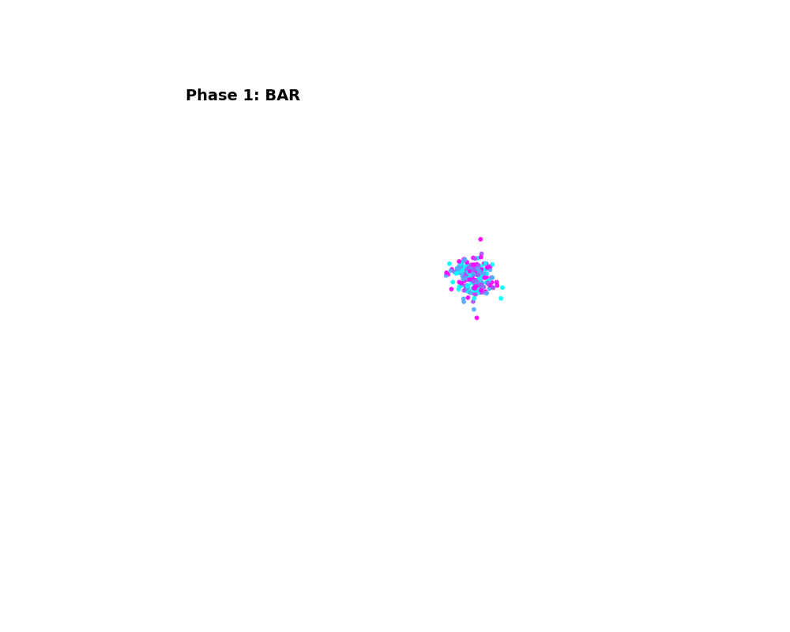

# Multicluster Design and Control of Large-Scale Affine Formations

This codebase provides the implementation for scalable topology design and control of affine formations for the paper: Multicluster Design and Control of Large-Scale Affine Formations.

Conventional affine formation control (AFC) is typically bottlenecked by the optimal topology design for communication costs and convergene speed, limiting swarm sizes to a few dozen agents. This project introduces a efficient optimization framework utilizing **geometric symmetry reduction (USI)** and a **multicluster control framework**, enabling rigid and articulated affine maneuvers for swarms of several hundred agents.

## 🚀 Features
* **General Convex Solutions:** An SDP formulation for any configurations, with tunable hyparameters control the sparsity of the graph and the convergence speed.

* **Scalable Topology Design:** Formulations that compress the dense $O(N^2)$ SDP search space down to $O(S)$ by exploiting geometric symmetry.
* **Multicluster Control:** Framework for subdividing massive swarms into local clusters, allowing for both monolithic rigid maneuvers and partial-collective (articulated) motions.
* **Extensive Benchmarks:** Built-in configurations for testing random point clouds (up to 500 agents), regular polygons, 3D Platonic/Archimedean solids (Cuboctahedron, Truncated Icosahedron), and cluster-based geometries.

## 🛠️ Installation & Setup
This setup is tested on Ubuntu 24.04LTS with Python 3.12.12

1. **Clone the repository:**
   ```bash
   git clone https://github.com/zlipro/large-afc.git
   cd large-afc
   ```
2. **Install Python dependencies:**
    ```bash
    pip install -r requirements.txt
    ```
3. SDP Solver Requirement:
Because this project relies heavily on solving Semidefinite Programs (SDPs), you will need a robust interior-point solver. We highly recommend installing MOSEK (free academic licenses available) or SCS/CVXOPT for use with CVXPY.

4. Make the run script executable:
    ```bash
    chmod +x run.sh
    ```

## 📁 Repository Structure
* `run.sh`: Master execution script.

* `configs/`: YAML configuration files defining the geometry parameters, solver settings, and agent counts for each benchmark.

* `exp/`: Core experiment scripts.

    *  `benchmarks/`: Scripts to run SDP optimization (benchmark.py, benchmark-linked-geometry.py) and plotting/data extraction (evaluate.py).
* `results/`: the stress matrices from the benchmarks and the realated plots from evaluation.

* `src/`: The scripts for proposed algorithms and the state-of-the-arts.

* `demo.py`: the demo script using the Letter-W configuration for multicluster control

## 🏃 Quick Start (Demo)
To instantly see the multicluster AFC in action using the "Letter W" linked geometry, simply run the script with no arguments (or the -demo flag):
    ```bash
    ./run.sh -demo
    ```
This will compute the optimal stress matrices, simulate the formation maneuver, and generate the corresponding trajectory plots.
<p align="center">
  
</p>

## 📊 Reproducing Paper Results
We have provided a unified bash script (run.sh) to effortlessly run all benchmarks, evaluations, and specialized experiments. Use

```bash
./run.sh -help
```
to checkout all options.

1. **Running Benchmarks**
Benchmarking takes a long time. You could change the number of Monte Carlo runs in config files at `/configs/benchmarks`. The results are already included in `/results/stress_mats`
```bash
# Run a specific benchmark case
./run.sh -benchmark random-100

# Run a symmetric 3D geometry
./run.sh -benchmark cuboctahedron

# Run ALL benchmark cases sequentially
./run.sh -benchmark
```
2. **2. Evaluating Results & Generating Plots**
Once benchmarks are generated, use the -evaluate flag to process the data, calculate convergence rates/spectral efficiencies, and plot the graphs.
```bash
# Evaluate a specific case
./run.sh -evaluate random-100

# Evaluate all individual cases
./run.sh -evaluate

# Generate aggregate comparison plots (Convergence, Edge Counts, Spectral Efficiency) across ALL cases
./run.sh -evaluate all-metrics
```
